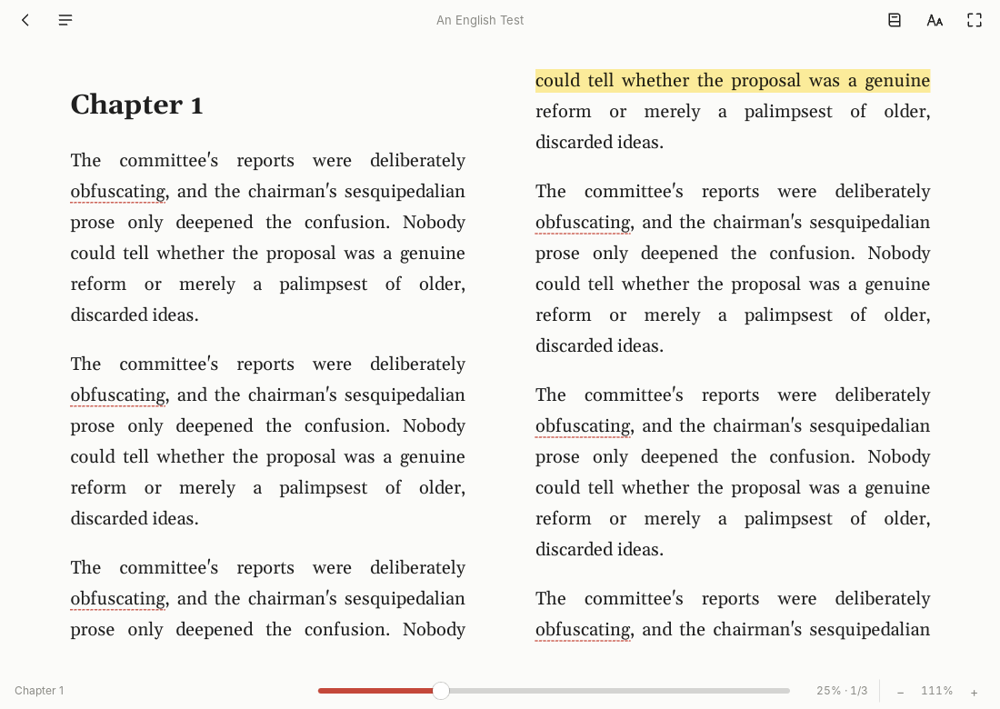

# OmniReader

Linux 向けの軽量・高速なリーダー。電子書籍、PDF、テキスト、Markdown、HTML、ソースコードをこれ一つで読めます。

[Tauri](https://tauri.app)（Rust）と [foliate-js](https://github.com/johnfactotum/foliate-js)（[Foliate](https://johnfactotum.github.io/foliate/) の描画エンジン）で作られています。本体は約 7MB で、表示にはシステムの WebKitGTK を使います。

[English README](README.md)



## 主な機能

- **対応形式**
  - EPUB（縦書き対応）、MOBI、AZW3、FB2、CBZ
  - PDF（前後のページを先読みするので、ページめくりが速い）
  - TXT（文字コード自動判別、青空文庫のルビと見出しに対応）
  - Markdown
  - HTML
  - ソースコード約80種（行番号とシンタックスハイライト付き。txt の中身がコードなら自動でコード表示）
- **表示**
  - テーマは白・セピア・黒
  - フォント、文字サイズ、行間、本文幅を調整できる
  - ページ表示とスクロール表示、1段と見開き
  - ズームは `Ctrl +` / `Ctrl −`、Ctrl+ホイール、右下のボタン
- **マーカーとメモ**
  - 4色のマーカーとメモ
  - `Ctrl+Z` で取り消し、`Ctrl+Shift+Z` でやり直し
  - メモ一覧から Markdown で書き出せる
- **自作単語帳**
  - 知らない単語だけを、自分の訳で登録する
  - 例文と書名は自動で保存される
  - 登録した単語は、どの本でも点線付きで表示され、活用形も拾う
  - 意味を書くときの参考に Wiktionary の定義を表示する
  - TSV/CSV の入出力ができ、Anki や表計算と連携できる
- **その他**
  - UI は日本語と英語
  - 本や HTML 内のスクリプトは実行しない
  - 大きいファイルは必要な部分だけ読み込む

## インストール

1. WebKitGTK 4.1 を入れる（例: `sudo apt install libwebkit2gtk-4.1-0`。ほかのディストリは [README.md](README.md#installation) を参照）。
2. [Releases](../../releases) から入手して展開し、次を実行する。
   ```sh
   tar xzf omnireader-linux.tar.gz && cd omnireader && ./install.sh
   ```
   ソースから入れる場合は、Rust と `libwebkit2gtk-4.1-dev` を入れてから `./install.sh` を実行する（自動でビルドされる）。
3. 更新は `./install.sh` をもう一度実行する。アンインストールは `./install.sh --uninstall`。どちらもデータは消えない。

## 操作

| 操作 | キー |
|---|---|
| ページ送り | ← → / Space / ホイール / 画面の左右端をクリック |
| メニューの表示切替 | 画面中央をクリック |
| 目次 / メモ一覧 / 単語帳 | T / N / W |
| ズーム | Ctrl + / Ctrl − / Ctrl 0、Ctrl+ホイール |
| 取り消し / やり直し | Ctrl+Z / Ctrl+Shift+Z |
| 全画面 | F / F11 |
| 開く | Ctrl+O、またはウィンドウにドロップ |
| 戻る | Esc |

## トラブルシューティング

- `libwebkit2gtk-4.1.so.0` が見つからない場合は、上の手順1を実行する。
- 画面が真っ白、または重い場合（NVIDIA 環境など）は、`WEBKIT_DISABLE_DMABUF_RENDERER=1 omnireader` で起動する。
- 英語の本で単語の間が空きすぎる場合は、`sudo apt install hyphen-en-us` を実行する。
- 速度を計測したい場合は、`OMNIREADER_DEBUG=1 omnireader file.pdf` で起動する。

## データの保存場所

- 本棚・読書位置・マーカー・設定: `~/.local/share/io.github.omnireader/`
- 単語帳: `~/.local/share/omnireader/wordbook.json`

旧名（Shiori）時代のデータは、初回起動時に自動で引き継がれます。

## ライセンス

MIT。同梱ライブラリのライセンスは [THIRD_PARTY_NOTICES.md](THIRD_PARTY_NOTICES.md) を参照してください。
