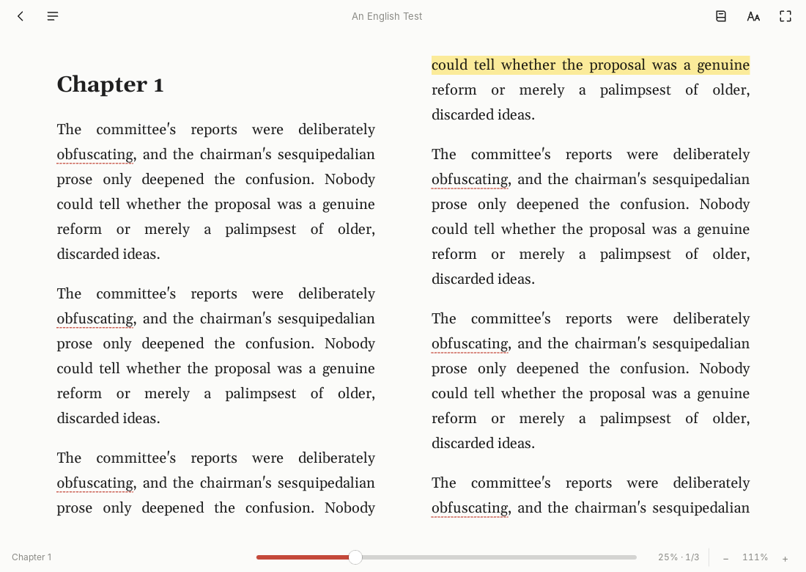
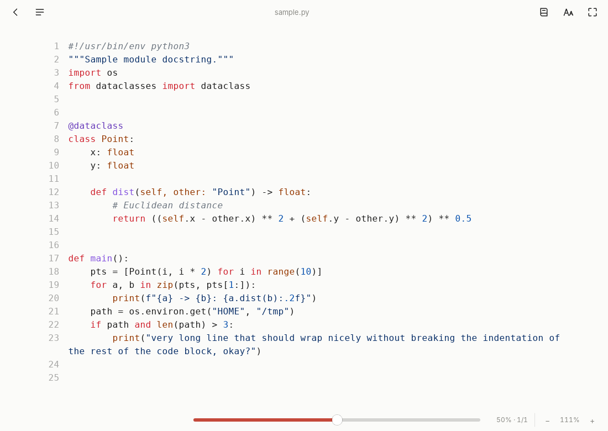
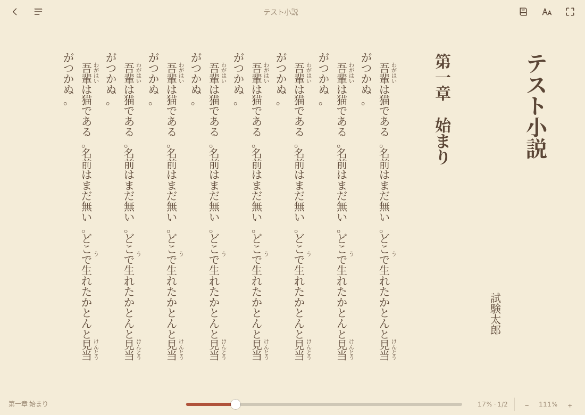

# OmniReader

A lightweight, fast reader for Linux that opens almost anything you read: e-books, PDFs, plain text, Markdown, HTML and source code.

Built with [Tauri](https://tauri.app) (Rust) and [foliate-js](https://github.com/johnfactotum/foliate-js), the rendering engine behind [Foliate](https://johnfactotum.github.io/foliate/). The binary is about 7 MB and uses your system's WebKitGTK.

[日本語の README はこちら](README.ja.md)



| Source code view | Vertical Japanese text |
|---|---|
|  |  |

## Features

**Formats**
- E-books: EPUB (including vertical writing), MOBI, AZW3, FB2, CBZ
- PDF, with neighbouring pages pre-rendered for instant page turns
- Plain text: encoding is auto-detected (UTF-8, Shift_JIS, EUC-JP, UTF-16), Aozora Bunko ruby and heading markup are supported, and chapter headings become a table of contents
- Markdown, with tables, code blocks and local images
- HTML, with scripts removed
- Source code in about 80 languages, with line numbers and syntax highlighting. A `.txt` file that contains code is detected automatically.

**Reading**
- Light, sepia and dark themes; publisher, serif or sans fonts; adjustable font size, line spacing and text width
- Paginated or scrolled layout; single or two columns
- Zoom with `Ctrl +` / `Ctrl −`, `Ctrl` + mouse wheel, or the controls in the bottom-right corner
- Reading position is remembered for every book, and opened books are listed in a library with covers and progress

**Highlights and notes**
- Select text to highlight it in four colours, attach a note, or copy it
- `Ctrl+Z` / `Ctrl+Shift+Z` undo and redo
- A notes list for each book, which you can export as Markdown
- Works in EPUB-type books, text files and PDFs that contain text

**Personal word book**

Made for readers who already know most words and only want to keep track of the rare ones.
- Select a word and choose **Dictionary** to save your own definition. The sentence it appeared in and the book title are stored as an example.
- Saved words get a dotted underline in every book. Click one to see your definition. Inflected forms are matched too: `obfuscate` also marks *obfuscating* and *obfuscated*.
- Wiktionary definitions are shown as a reference (internet connection required). Click one to copy it into your definition. There are also buttons to look the word up on Wiktionary, Eijiro or Google in your browser.
- Import and export as TSV/CSV, which works with Anki and spreadsheets.

**Other**
- English and Japanese user interface
- Scripts inside books and HTML files never run (a Content-Security-Policy is applied to every page)
- Files over 24 MB are read on demand, so even very large PDFs open quickly

## Installation

### 1. Install WebKitGTK 4.1

Most GNOME-based desktops already have it.

| Distribution | Command |
|---|---|
| Ubuntu 22.04+ / Debian 12+ / Mint | `sudo apt install libwebkit2gtk-4.1-0` |
| Fedora | `sudo dnf install webkit2gtk4.1` |
| Arch / Manjaro | `sudo pacman -S webkit2gtk-4.1` |
| openSUSE | `sudo zypper install libwebkit2gtk-4_1-0` |

### 2a. Install a release build

Download the archive from [Releases](../../releases), then:

```sh
tar xzf omnireader-linux.tar.gz
cd omnireader
./install.sh
```

This installs `~/.local/bin/omnireader` and adds OmniReader to your application menu. No `sudo` is needed.

### 2b. Build from source

You need [Rust](https://rustup.rs) and the WebKitGTK development packages:

```sh
# Ubuntu / Debian
sudo apt install libwebkit2gtk-4.1-dev build-essential librsvg2-dev
# Fedora
sudo dnf install webkit2gtk4.1-devel openssl-devel librsvg2-devel
# Arch
sudo pacman -S webkit2gtk-4.1 base-devel librsvg

git clone https://github.com/<you>/omnireader.git
cd omnireader
./install.sh            # builds with cargo if no prebuilt binary is present
```

To build `.deb` and AppImage packages, run `cargo install tauri-cli` and then `cd src-tauri && cargo tauri build`.

### Updating and uninstalling

- **Update:** download or pull the new version and run `./install.sh` again. Your library, notes and word book are kept.
- **Uninstall:** `./install.sh --uninstall`. Your data is kept.

## Usage

There are three ways to open a file:
- Run `omnireader path/to/file`
- Drag a file onto the window
- Press `Ctrl+O`

Files with e-book or PDF extensions are associated with OmniReader. Text, Markdown, HTML and code files are not, so OmniReader doesn't replace your editor or browser as the default app for them.

### Keyboard shortcuts

| Action | Keys |
|---|---|
| Next / previous page | `→` `←`, `Space` / `Shift+Space`, `PageDown` / `PageUp`, mouse wheel, or click the left/right edge of the page |
| Show / hide toolbars | Click the middle of the page |
| Table of contents | `T` |
| Notes list | `N` |
| Word book | `W` |
| Zoom (font size for books, scale for PDFs) | `Ctrl +` / `Ctrl −` / `Ctrl 0`, `Ctrl` + wheel |
| Undo / redo highlight changes | `Ctrl+Z` / `Ctrl+Shift+Z` (or `Ctrl+Y`) |
| Fullscreen | `F` or `F11` |
| Open file | `Ctrl+O` |
| Back to library / close panels | `Esc` |

In the note editor and the word dialog, `Ctrl+Enter` saves.

### Word book file

The word book is a single JSON file at `~/.local/share/omnireader/wordbook.json`. To back it up or sync it, copy that file. The TSV export uses these columns:

```
word	meaning	example	book
```

## Troubleshooting

- **`error while loading shared libraries: libwebkit2gtk-4.1.so.0`**: install WebKitGTK (see step 1 above).
- **Blank window or slow rendering, especially on NVIDIA:** start the app with `WEBKIT_DISABLE_DMABUF_RENDERER=1 omnireader`, or try `WEBKIT_DISABLE_COMPOSITING_MODE=1`. To make the setting permanent, put it in the `Exec=` line of `~/.local/share/applications/omnireader.desktop`, for example `Exec=env WEBKIT_DISABLE_DMABUF_RENDERER=1 omnireader %f`.
- **Large gaps between words in English books:** install hyphenation dictionaries: `sudo apt install hyphen-en-us` (Fedora: `hyphen-en`).
- **Performance logging:** start the app with `OMNIREADER_DEBUG=1 omnireader file.pdf` to print load and page-render times to the terminal.

## Data locations

| What | Where |
|---|---|
| Library, reading positions, highlights, notes, settings | `~/.local/share/io.github.omnireader/` (WebView storage) |
| Word book | `~/.local/share/omnireader/wordbook.json` |

If you used the app under its earlier name (Shiori), your data is migrated automatically on first launch.

## Project structure

```
src-tauri/src/main.rs   Rust backend: file I/O, dialogs, word-book storage (~250 lines)
ui/index.html           UI markup
ui/app.js               Reader UI: library, settings, highlights, word book, input
ui/textbook.js          Converts TXT, Markdown, HTML and code into books
ui/wordbook.js          Word book data, inflection matching, TSV, Wiktionary lookup
ui/i18n.js              English and Japanese UI strings
ui/foliate-js/          Rendering engine (slightly modified: PDF page cache, faster page turns)
ui/vendor/              marked, highlight.js
```

## License

OmniReader is released under the [MIT License](LICENSE). Bundled third-party components keep their own licenses; see [THIRD_PARTY_NOTICES.md](THIRD_PARTY_NOTICES.md).
